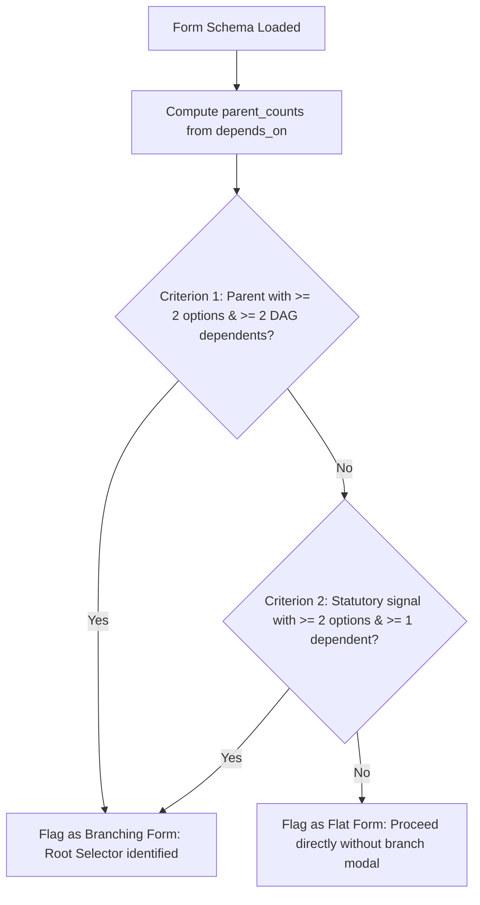

# IDP Studio: Generic Agentic Form Pipeline Architecture

## 1. Executive Overview

The IDP Studio Form Engine automates the ingestion, extraction, semantic mapping, validation, and filling of Ministry of Corporate Affairs (MCA) statutory forms (54+ forms including GNL-2, MGT-14, PAS-6, ADT-1, INC-20A, LLP-8, LLP-11).

The architecture is built on a **zero-hallucination, configuration-driven multi-agent framework** where:
1. **Form Definitions & Schemas** are extracted with **100% deterministic PDF geometry and statutory grammars** directly from MCA Instruction Kit PDFs without generative LLM guesswork.
2. **Execution & Cognitive Tasks** are distributed across specialized, right-sized local models and deterministic extractors to maintain sub-3.5s latency, prevent Ollama queue stalls, and enforce strict legal fidelity.

---

## 2. Multi-Agent & Heterogeneous Model Allocation

Rather than routing all tasks through a monolithic general-purpose model, the engine assigns specialized components to discrete stages:

```mermaid
graph TD
    subgraph Intake ["1. Document Layout & Intake"]
        PDF[Instruction Kit PDF / Dossier PDFs] --> DOC_AGENT[DocLayoutAgent: Triton marker_model + pdfplumber]
        DOC_AGENT --> MD[Physical Canvas Geometry & Structured Text]
    end

    subgraph Compiler ["2. Deterministic Schema Compilation"]
        MD --> COMPILER[SchemaCompilerAgent: Pure Python Geometry & AST]
        COMPILER -->|AST Fallback for Custom Tables| CODER[qwen2.5-coder:7b]
        COMPILER --> REGISTRY[(Universal Form Registry & SQLite)]
    end

    subgraph Triage ["3. Document Classification"]
        MD --> TRIAGE_AGENT[DocTriageAgent: qwen3.5:4b]
        TRIAGE_AGENT -->|Sub-150ms classification| DOC_TYPE[Document Type Tag]
    end

    subgraph Extraction ["4. 3-Tier Statutory Extraction"]
        DOC_TYPE --> MAP_AGENT[StatutoryMappingAgent]
        REGISTRY --> MAP_AGENT
        MAP_AGENT -->|Tier 1: < 5ms| T1[Deterministic Regex & Universal Statutory Grammars]
        MAP_AGENT -->|Tier 2: < 10ms| T2[Learned DOM Rules & Schema Aliases]
        MAP_AGENT -->|Tier 3: Scoped| T3[qwen2.5:14b (Only for Unmapped Options)]
    end

    subgraph Validation ["5. Validation & Pruning"]
        T1 --> VAL_AGENT[FormValidationAgent: Pure Python]
        T2 --> VAL_AGENT
        T3 --> VAL_AGENT
        VAL_AGENT -->|Sub-millisecond| PAYLOAD[Validated Form Execution Payload]
    end
```

### Component Matrix

| Agent / Component | Underlying Engine | Role & Responsibility | Latency SLA |
|---|---|---|---|
| **DocLayoutAgent** | Triton `marker_model` (`:8000`) + `pdfplumber` | Canvas layout, bounding box coordinates, line deduplication, Part III scanline slicing. | ~300ms |
| **DocTriageAgent** | `qwen3.5:4b` (`:11434`) | Rapid document categorization (board resolutions, consents, notices). | < 150ms |
| **SchemaCompilerAgent** | Deterministic 6-Stage Procedural Engine + `qwen2.5-coder:7b` | Extracts fields, canonical numbers, options, table schemas, and DAG conditions verbatim from Instruction Kits. | ~1.2s (one-time) |
| **StatutoryMappingAgent** | `UniversalStatutoryExtractor` + `idp_dom_extraction_rules` + `qwen2.5:14b` | Resolves statutory identifiers (CIN, PAN, DIN, SRN, Dates) and dropdown options against source evidence. | Avg < 250ms |
| **FormValidationAgent** | Pure Python Rule & DAG Engine | Enforces `DD/MM/YYYY` date grammar, deactivates dormant branches, checks required fields. | < 10ms |

---

## 3. The 6-Stage Deterministic Instruction Kit Compilation Engine

Form schemas are **never generated out of thin air by an LLM**. The 6-stage compiler in `automation_engine/modules/idp_studio/forms/stages/` extracts ground-truth statutory definitions:

1. **Stage 1 — PDF Understanding (`stage1_pdf_layout.py`):**
   - Uses `pdfplumber` to inspect raw character stream and `(x, y)` canvas coordinates.
   - Dynamically locates **Part III: Field-wise Instructions**.
   - Slices scanlines into the 3 statutory columns:
     - Column 1 (`x < col1_max`): Serial Number / Field Number (`1`, `2(b)`, `3(a)`).
     - Column 2 (`col1_max ≤ x < col2_max`): Field Name / Label (`Corporate Identity Number`).
     - Column 3 (`x ≥ col2_max`): Statutory Instructions and guidance.

2. **Stage 2 — Structure Identification (`stage2_structure.py`):**
   - Applies statutory regex `FIELD_NO_PAT` to Column 1.
   - Detects continuation lines where labels or instructions wrap across multiple scanlines.
   - Preserves exact physical sequencing.

3. **Stage 3 — Semantic Rule Inference (`stage3_instruction_ai.py`):**
   - Evaluates text patterns to infer field types deterministically:
     - Date fields: Matches `(DD/MM/YYYY)` or `"date"`.
     - File attachments: Matches `"Attachment"`, `"Copy of"`, `"Upload"`.
     - Radio options: Matches `"whether"`, `"Yes/No"`, `"Associate/Fellow"`.
     - Dropdown choices: Harvests single-quoted option strings (`‘...’`).
   - **Self-Synthesizing Parent Engine:** When MCA omits a self-explanatory parent field from the table (e.g., GNL-2 Field 2(a)), the engine scans child trigger instructions (`"is selected in field number 2(a) i.e. '...'"`), restores the parent field, auto-harvests all choices, and links dependent fields.
   - **Dynamic Table Coder:** If a table schema does not match existing templates, `qwen2.5-coder:7b` parses the instruction text into structured column definitions.

4. **Stage 4 — DAG Engine (`stage4_dag_engine.py`):**
   - Parses conditional trigger clauses (`"in case X is selected in field number Y"`).
   - Generates DAG dependency nodes with operator conditions (`equals`, `in`, `contains`).

5. **Stage 5 — Schema Validator (`stage5_validator.py`):**
   - Verifies DAG connectivity, checks for dangling branches, and eliminates duplicate options.

6. **Stage 6 — Schema Generator (`stage6_generator.py`):**
   - Serializes the verified schema to production JSON stored in `FormRegistry` and SQLite `IdpTemplate`.

---

## 4. Universal Statutory Extractors

Located in [`automation_engine/modules/idp_studio/extractors/universal_statutory.py`](file:///Users/apple/Desktop/FLA/automation_engine/modules/idp_studio/extractors/universal_statutory.py):

- **CIN Extractor:** `\b([LU][0-9]{5}[A-Za-z]{2}[0-9]{4}[A-Za-z]{3}[0-9]{6})\b`
- **PAN Extractor:** Word-bounded `\b([A-Za-z]{5}[0-9]{4}[A-Za-z])\b` with explicit exclusion of `"company"`.
- **DIN Extractor:** Word-bounded 8-digit numeric matcher with DIN/DPIN prefixes.
- **Universal Date Normalizer:** Parses alphanumeric (`24th april 2025`, `April 24, 2025`), ordinal, ISO (`2025-04-24`), and DMY dates into standard statutory `DD/MM/YYYY`.
- **SRN Extractor:** Service request numbers (`[A-Za-z][0-9]{8}`).
- **Canonical Option Matcher:** 3-tier matcher (exact string &rarr; containment &rarr; token overlap) matching extracted document values to schema options.

---

## 5. Universal Schema Normalization Engine (`FieldNormalizer`)

Located in [`automation_engine/modules/idp_studio/forms/normalizer.py`](file:///Users/apple/Desktop/FLA/automation_engine/modules/idp_studio/forms/normalizer.py):

Acts as the **Single Source of Truth** across the entire pipeline. Automatically invoked inside `FormRegistry._standardize_schema` whenever a schema is loaded from SQLite or disk:

1. **Conservative Count Field Guard:**
   - Any field indicating cardinality (`Number of resolution(s)`, `No. of members`) is converted to `type: "number"`.
   - Instruction-kit text bleed and guidance notes are removed from options.
   - Statutory identifiers (DIN, PAN, CIN, Membership/Registration numbers) are explicitly guarded from being treated as counts via `IDENTIFIER_EXCLUSION_PATTERN`.

2. **Classification Code Guard:**
   - Sub-class and NIC classification fields (`sub-class`, `nic code`, `industry sub-class`) are normalized to `type: "text"`.
   - Rejects spurious boolean toggles (`['Yes']`, `['Yes', 'Type of Company']`).

3. **Instruction Header Row Sanitizer:**
   - Strips table header artifacts that bleed into options (e.g. `'Resolution(s)'`, `'Type of resolution'`, `'Attachment(s)'`).

4. **Degenerate Single-Option Select Conversion:**
   - Any dropdown or radio field with fewer than 2 valid options converts to `type: "text"` with `options: None`.

5. **Source Provenance & Audit Trails:**
   - Preserves `{original_type, original_options, normalization_applied: True, corrections: [...]}` under `field["provenance"]`.

---

## 6. Universal Semantic Branch Detection Engine

Replaces hardcoded whitelists (`BRANCH_ENABLED_FORMS`, `STATUTORY_BRANCH_WHITELIST`) with dynamic DAG divergence evaluation:



- **True Positive Branching:** ADT-1 (5 dependents), DIR-12 (3 dependents), GNL-1 (25 dependents), MGT-14 (10 dependents), LLP-8 (50 dependents), BEN-2 (34 dependents), INC-28 (6 dependents).
- **Zero False Positives on Flat Forms:** Karomi FLA, LLP-11, MGT-7, INC-20A, MGT-6, PAS-6, GNL-2 have 0 dependents gating divergent pathways and proceed directly.

---

## 7. Signatory Role Semantic Exclusivity Resolver

Located in `resolve_field_value` within [`automation_engine/modules/idp_studio/router.py`](file:///Users/apple/Desktop/FLA/automation_engine/modules/idp_studio/router.py#L648):

- Resolves statutory roles using **field semantics and explicit `Designation` metadata**, never guessing from identifier format alone.
- **Director Slot:** Only populated with DIN or designated Director PAN when `Designation` is Director / Managing Director.
- **Manager / CS Slot:** Only populated with ICSI membership or Manager PAN when `Designation` is Company Secretary / Manager.
- **Ambiguous Roles:** When source documents reference multiple roles or omit clear attribution, the value is left unassigned for human-in-the-loop review rather than being cross-pollinated.

---

## 8. Subfield Boundary Isolation, Structural Header Shielding & Multi-Date Disambiguation

Located in `resolve_field_value` and `_fast_path_extract_mca_fields` within [`automation_engine/modules/idp_studio/router.py`](file:///Users/apple/Desktop/FLA/automation_engine/modules/idp_studio/router.py):

- **Subfield Token Boundary Isolation:** Resolves field IDs by strict tail token isolation (`field_([0-9]+[a-z0-9]*)`). Parent fields (e.g. `field_3`) are strictly blocked from absorbing child subfield values (e.g. `field_3a`). Similarly, `field_4` cannot match `field_4p` or `field_4q`. Fuzzy ID matching is constrained to exact normalized string equality (`norm_k == norm_fid`).
- **Structural Header Shielding:** Identifies MCA instruction-kit section headings (`Particulars of...` / `Details of...` exceeding 10 words) and shields them from absorbing scalar numeric inputs (e.g., share counts or resolution counts), ensuring scalar inputs flow cleanly to leaf child fields.
- **Universal Multi-Date Disambiguation:** Under Section 89 and multi-date statutory forms (MGT-6, BEN-2, GNL-2), disambiguates:
  - *Date of Entry in Register of Members / Charges* (`m_entry_date` -> `field_4p`)
  - *Date of Receipt of Declaration by Company* (`m_receipt_date` -> `field_4r`)
  - *Date of Declaration* (`m_dec_date` -> `field_4q`, `field_6b`), strictly guarded against matching receipt declaration strings.
- **Universal Extraction Fast Path:** Executes across all MCA forms without template-specific conditional gating.

---

## 9. Directory Structure & Key Files

```text
automation_engine/modules/idp_studio/
├── core/
│   ├── db.py                     # SQLite engine & database initialization
│   ├── models.py                 # ORM models (IdpTemplate, SchemaAliasRule, DomExtractionRule)
│   └── llm_router.py             # Centralized LLM router with specialized model roles
├── extractors/
│   ├── classifier.py             # Document classification cascade
│   ├── spatial.py                # Scenario lexicon & spatial DOM rule lookup
│   └── universal_statutory.py    # Standardized statutory extractors & date normalizer
├── forms/
│   ├── normalizer.py             # FieldNormalizer: Single source of truth for schemas & provenance
│   ├── stages/                   # 6-Stage Deterministic Instruction Kit Parser
│   │   ├── stage1_pdf_layout.py
│   │   ├── stage2_structure.py
│   │   ├── stage3_instruction_ai.py
│   │   ├── stage4_dag_engine.py
│   │   ├── stage5_validator.py
│   │   └── stage6_generator.py
│   ├── filler.py                 # Autonomous FormFiller engine with DAG pruning
│   ├── kit_parser.py             # Public wrapper for 6-stage pipeline
│   └── registry.py               # FormRegistry catalog with embedded FieldNormalizer gateway
├── router.py                     # FastAPI REST API (semantic branch detection & resolve_field_value)
└── idp_studio.db                 # Persistent SQLite store
automation_engine/
├── scripts/
│   ├── migrate_gnl1_schema.py                        # GNL-1 51-field & compounding migration
│   └── migrate_universal_schema_normalization.py     # Idempotent, reversible DB normalization
└── tests/
    ├── test_universal_engine.py                      # Comprehensive universal engine test suite
    └── test_gnl1_branch_and_dag.py                   # GNL-1 branch & DAG regression tests
```
